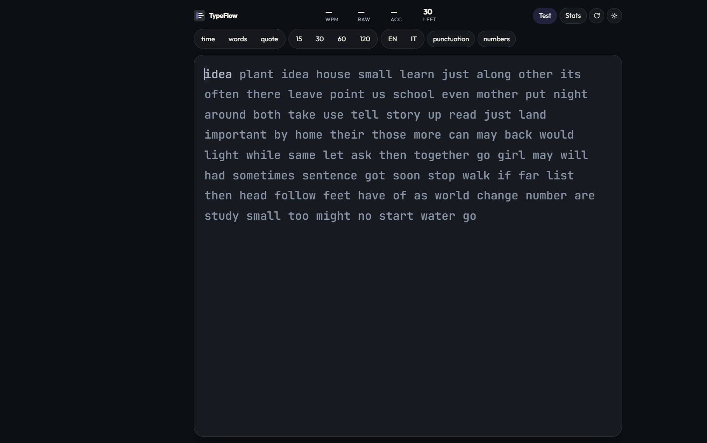

# TypeFlow

A calm, precise typing speed test. Time, word, and quote sessions, live accuracy, and a results page you can share.

**Live demo:** https://adripo.github.io/typeflow/



## Features

- Time tests (15s, 30s, 60s, 120s), word counts (10, 25, 50, 100), and quote mode
- English and Italian word lists, plus famous public-domain quotes
- Punctuation and numbers when you want a harder passage
- Character-by-character feedback, extra letters, and a smooth caret
- Live net WPM, raw WPM, accuracy, and timer
- Results with consistency, character totals, a per-second pace chart, a keyboard heatmap, and your slowest and most mistyped words
- History in the browser: personal bests, averages, a progress chart, total time typed, and a daily streak
- Export history as CSV, or reset it after a confirmation
- Five themes, saved locally, with the system light or dark theme as the default
- A downloadable result card
- Works with a desktop keyboard and with a Bluetooth or USB-C keyboard on a phone or tablet
- Responsive layout, including a compact phone landscape view
- Installable from the home screen

## Tech stack

- HTML, CSS, and vanilla JavaScript modules
- [Chart.js](https://www.chartjs.org/) 4 from a CDN
- [Outfit](https://fonts.google.com/specimen/Outfit) and [JetBrains Mono](https://fonts.google.com/specimen/JetBrains+Mono) from Google Fonts
- `localStorage` for settings, theme, and history
- GitHub Pages, deployed from the `main` branch by GitHub Actions

There is no build step. TypeFlow uses [semantic versioning](https://semver.org/). The current release is **1.0.0**. Changes are recorded in [CHANGELOG.md](CHANGELOG.md).

## Run it locally

Modules and the word lists are loaded over HTTP, so open the folder with a static server rather than as a `file://` page.

```powershell
python -m http.server 8080
```

Then visit http://127.0.0.1:8080/

On a phone, use the same Wi-Fi and open `http://<this-computer-lan-ip>:8080/`. Tap the passage and type. A Bluetooth or USB-C keyboard is the best way to take the test. The on-screen keyboard still works.

## Project structure

```
index.html
css/styles.css
js/app.js        boot, settings, shortcuts
js/test.js       passage, input, and metrics
js/stats.js      bests, streak, averages, CSV
js/storage.js    localStorage
js/ui.js         rendering, charts, heatmap, share card
assets/          words, quotes, icons, preview
manifest.webmanifest
```

## This project was built with AI using Cursor

The code in this repository was generated and iterated with an AI pair programmer in Cursor. The typing engine, interface, themes, mobile keyboard handling, and deployment workflow were written in conversation, then checked in the browser and adjusted where the test, chart, or layout needed it. It is a finished static site, not a generated draft left untouched.
